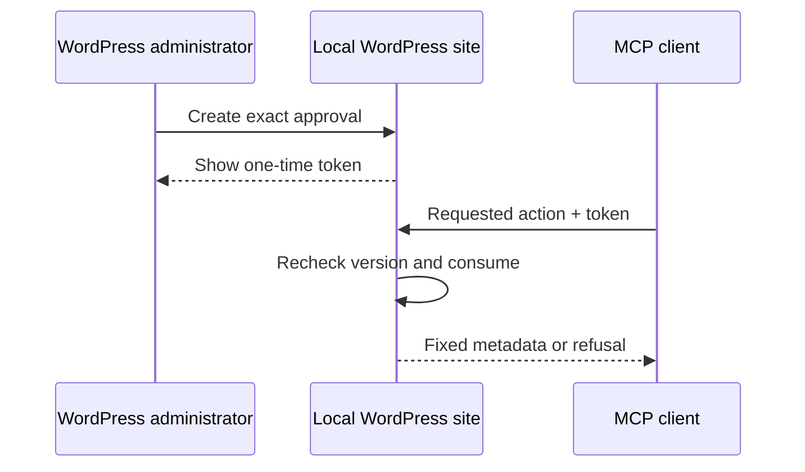

# M5 intent: controlled content workflow

## Outcome

A WordPress developer can move one standard post through a deliberate lifecycle—publish, schedule, trash, or restore—only after a WordPress administrator issues a short-lived, one-time approval for that exact effect.

## Effect boundary

M5 adds four explicit lifecycle abilities:

| Ability | Admitted source state | Effect |
|---|---|---|
| `kiln/publish-post` | `draft` | publish immediately |
| `kiln/schedule-post-publication` | `draft` | schedule one future publication |
| `kiln/trash-post` | `draft` or `publish` | move one post to WordPress trash |
| `kiln/restore-post` | `trash` | restore one trashed post to its stored prior state |

Every action accepts exactly one post ID, its current opaque modification token, and a one-time approval token. Scheduling additionally accepts one bounded UTC timestamp. No ability accepts a status field, author, taxonomy, custom fields, content, media, options, bulk target, or generic action selector.

## Human approval boundary

An administrator creates an approval locally in the WordPress dashboard. The approval is bound to one action, one post, and that post's current modification token; its raw value is shown only once. Kiln stores only a hash, an expiry, and a consumed marker locally. It never creates an approval through MCP, returns an approval token, or sends approval information remotely.

## Safety and recovery

All mutations recheck target admission, WordPress `edit_post`, current version, approval binding/expiry, and token state immediately before the effect. A successful result returns fixed metadata and a new modification token. A repeated, stale, expired, mismatched, or already-consumed approval is denied without changing the post.

Trash is the only destructive operation admitted by M5, and restoration is an explicit paired capability. Permanent deletion remains excluded.

## Exit decision

M5 exits only after proof of administrator-local approval issuance, positive lifecycle transitions, wrong-action/wrong-target/stale-version/expired-or-replayed-token refusal, author/editor/subscriber boundaries, repeat behavior, recovery through restore, redacted audit evidence, and M1–M4 regression coverage.
