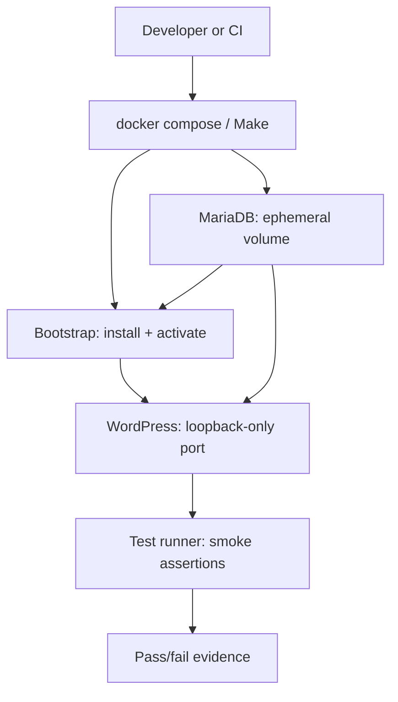

# Containerized test environment

Kiln MCP uses a disposable Docker Compose environment for real-WordPress integration and smoke testing. It is the authoritative local test path for macOS Apple Silicon and Linux; CI executes the same commands on Linux.

## Why an image-built environment

The test image assembles the plugin, including its production Composer dependencies, before WordPress starts. This is intentional:

- validates the installable artifact rather than an editor bind mount;
- avoids slow host-volume behavior on macOS virtualized container engines;
- selects native multi-architecture images automatically on Apple Silicon and Linux;
- leaves no production site, credentials, or persistent test state behind after cleanup.

## Topology



The host port is bound only to `127.0.0.1`. Containers use test-only credentials and a named volume; `make container-down` removes both volumes.

## Quick start

```sh
make container-preflight
make container-test
make container-down
```

The test site is available only while the stack is up at <http://127.0.0.1:8080>.

## Rancher Desktop on macOS

1. Select the **Moby/dockerd** container engine in Rancher Desktop so the Docker CLI and Compose v2 are available.
2. Select the Rancher Desktop Docker context with `docker context use rancher-desktop` when needed.
3. Run `make container-preflight`; it verifies the daemon, selected context, architecture, and Compose v2.
4. Run `make container-test`.

Kiln never requires Docker TCP port 2375. Rancher Desktop may expose the default Unix socket only when Administrative Access is enabled; use its selected Docker context instead of inventing a TCP daemon endpoint.

## Linux

Install Docker Engine plus the Compose v2 plugin, ensure your user can access the daemon, then run the same three commands. The Compose file does not set `platform:`, allowing native `linux/arm64` and `linux/amd64` image selection.

## Commands

| Command | Purpose |
|---|---|
| `make container-preflight` | fail fast on missing daemon, Compose v2, or insecure TCP configuration |
| `make container-build` | build the plugin-aware WordPress image |
| `make container-up` | start an inspectable test stack |
| `make container-test` | build, bootstrap WordPress, activate Kiln MCP, and run smoke checks |
| `make container-logs` | show combined diagnostics |
| `make container-down` | stop services and delete test volumes |

## Current assertions

The smoke runner proves WordPress is installed, Kiln MCP activates without an error, the REST index responds, and Milestone 0 exposes no Kiln MCP namespace. Future feature slices add focused integration, MCP contract, authorization, and adversarial tests here; they must not replace this baseline.

## Image maintenance

Images use explicit version tags, not `latest`. Refresh them deliberately in a dependency-maintenance change, validating both Apple Silicon and Linux before merging.
