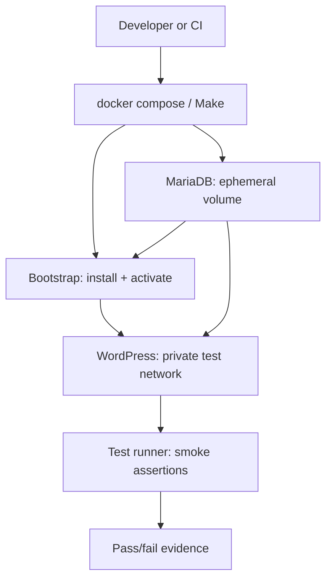

# Containerized test environment

Kiln MCP uses a disposable Docker Compose environment for real-WordPress integration and smoke testing. It is the authoritative local test path for macOS Apple Silicon and Linux; CI executes the same commands on Linux.

## Why an image-built environment

The test image assembles the plugin, including its production Composer dependencies, before WordPress starts. This is intentional:

- validates the installable artifact rather than an editor bind mount;
- avoids slow host-volume behavior on macOS virtualized container engines;
- selects native multi-architecture images automatically on Apple Silicon and Linux;
- leaves no production site, credentials, or persistent test state behind after cleanup.

## Topology



The bootstrap grants the WordPress web user ownership of `wp-content`, including `uploads`; the smoke suite creates and removes a probe there as that user before it starts protocol tests. Automated tests use only the private `wordpress` service DNS and publish no host port, so they cannot collide with another local service. Bootstrap stores a loopback URL as the WordPress site URL and the smoke runner sends its matching Host header. `make container-up` adds a loopback-only browser overlay for manual inspection. Containers use test-only credentials and a named volume; `make container-down` removes both volumes.

## Quick start

For a release ZIP without installing Composer or a zip utility on the host, use the same container runtime:

    make release-container-check
    make release-container

The artifact and SHA-256 sidecar are written to `dist/`. The normal `make release` target remains available for hosts that already provide Composer and `zip`.

```sh
make container-preflight
make container-test
make container-down
```

`make container-test` deliberately does not expose a browser port. For an inspectable local site, run `make container-up`; it uses <http://127.0.0.1:8080> by default. If that port is occupied, choose another loopback port, for example `KILN_MCP_TEST_PORT=8081 make container-up`.

## Rancher Desktop on macOS

1. Select the **Moby/dockerd** container engine in Rancher Desktop so the Docker CLI and Compose v2 are available.
2. Select the Rancher Desktop Docker context with `docker context use rancher-desktop` when needed.
3. Run `make container-preflight`; it verifies the daemon, selected context, architecture, and Compose v2.
4. Run `make container-test`.

Kiln never requires Docker TCP port 2375. Rancher Desktop may expose the default Unix socket only when Administrative Access is enabled; use its selected Docker context instead of inventing a TCP daemon endpoint.

## Linux

Install Docker Engine plus the Compose v2 plugin, ensure your user can access the daemon, then run the same three commands. The Compose file does not set `platform:`, allowing native `linux/arm64` and `linux/amd64` image selection.

## Commands

| Command | Purpose |
|---|---|
| `make container-preflight` | fail fast on missing daemon, Compose v2, or insecure TCP configuration |
| `make container-build` | build the plugin-aware WordPress image |
| `make container-up` | start an inspectable test stack with a loopback-only browser port; print service logs automatically if startup fails |
| `make container-test` | build, bootstrap WordPress, activate Kiln MCP, and run smoke checks; print service logs automatically if startup fails |
| `make container-logs` | show combined diagnostics for a still-running stack |
| `make container-down` | stop services and delete test volumes |

## Current assertions

The complete regression smoke runner proves all prior milestone contracts. M9 additionally builds the production-only artifact through the quality gate, validates its checksum/contents, and renders the bounded administrator operator-status view without sensitive disclosure. M11 proves bounded page discovery and plain-text page reads, refusal of private/future and malformed requests, subscriber denial, and unchanged page state. Earlier M2-specific assertions remain part of the same suite:


- WordPress, MCP Adapter, and Kiln MCP activate correctly;
- an administrator can execute the bounded site-health capability;
- an author can list no more than 20 published or self-authored draft metadata records;
- private posts and another user's drafts are excluded;
- subscribers are denied both capabilities; and
- locally retained audit receipts use the exact redacted contract for allowed and denied discovery attempts.

## Image maintenance

Images use explicit version tags, not `latest`. Refresh them deliberately in a dependency-maintenance change, validating both Apple Silicon and Linux before merging.
